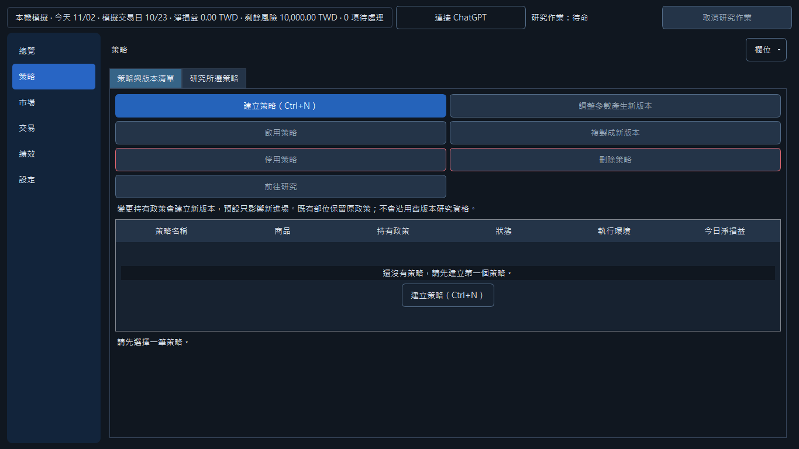
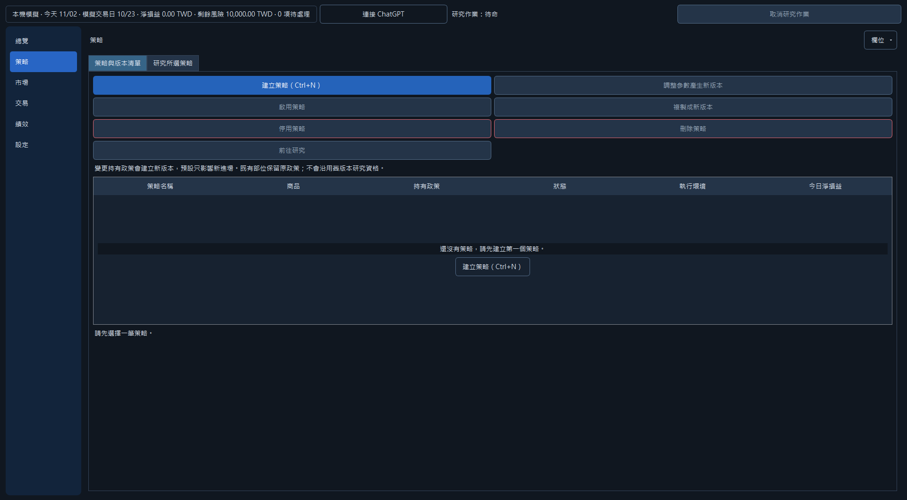
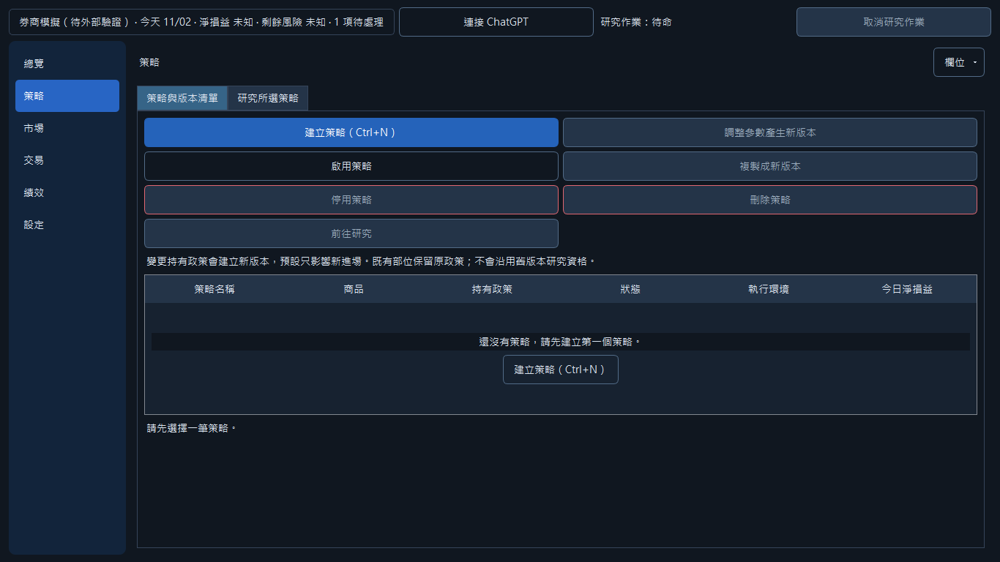
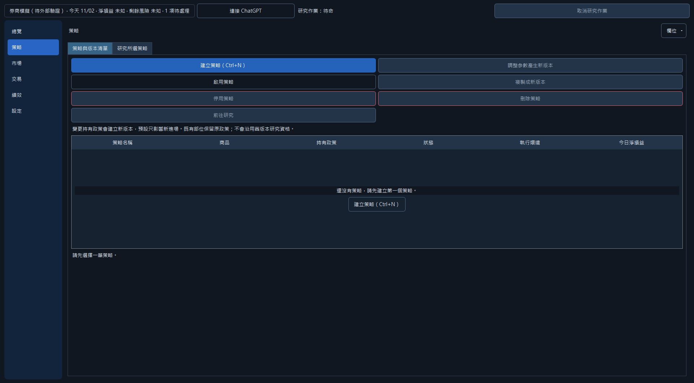
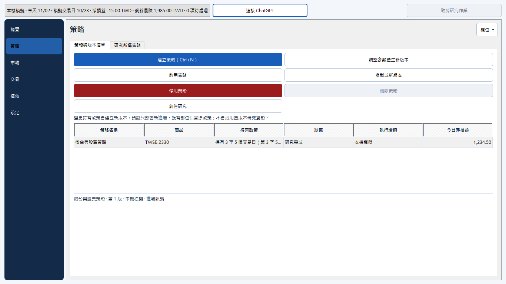
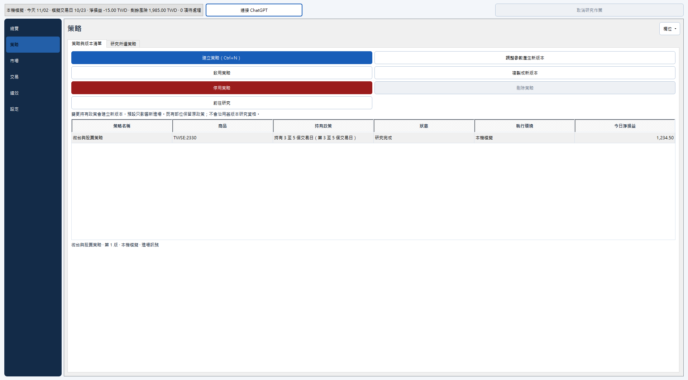
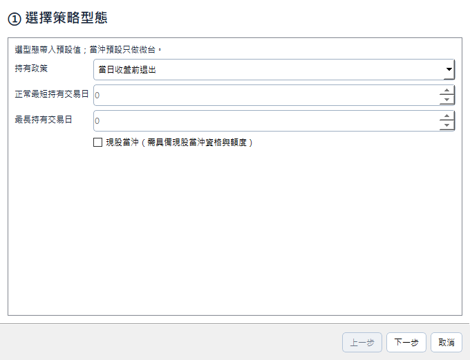
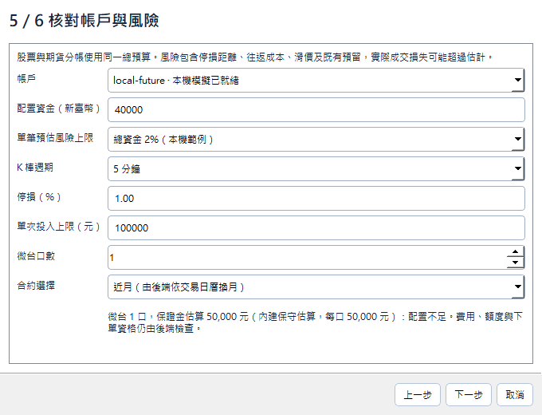

# U3 typed strategy presentation

U3 starts from main 0b760665, which contains the merged U2 and M2-9 contracts.
The wizard chooses holding kind first and applies the accepted defaults. Its
products come exclusively from strategy_products: intraday defaults to TMF;
optional stock intraday requires an explicit qualification confirmation whose
default is Cancel. Swing and position use the backend stock/ETF list. Rules use
the existing templates or structured JSON. Typed parameters preserve interval,
stop, per-entry amount, contracts and the instrument rule.

The list retains six default columns, remembered optional columns, environment,
daily PnL and recent signal. Exact-version operations disable, clone, revise or
delete. Disable/delete and activation use Cancel-default confirmations. Missing
research shows its reason and a button to the selected strategy's research tab.
Polling cannot re-enable an activation blocked by missing evidence or selection.
LIVE activation is refused by both the control and the shared command boundary;
the existing exact LIVE_ORDER_ACTIONS pin remains unchanged.

## Contract limits and decisions

- No quantlab, domain, application or IPC changes. Existing CREATE_TYPED_STRATEGY,
  REVISE_STRATEGY and management commands are used. Only draft metadata may retry
  once after a known CAS refusal; asset commands and unknown results never retry.
- StrategyView does not contain the full original form, direction or rules.
  Revision restores the known fields and requires explicit direction/rule choices.
  It creates an unresearched version, without silently inheriting old evidence.
- No can_delete or complete historical-fill proof is supplied. Visible managed
  positions disable deletion; a backend strategy_has_fills refusal is remembered
  for that exact context/version. The backend always decides historical eligibility.
- Stock sizing is an explicitly labelled whole-lot estimate before fees. The
  backend performs authoritative fee/slippage and cash checks. TMF shows contracts
  and available margin or the accepted conservative TWD50000 estimate. Neither
  display grants submission permission. Request authoritative size previews and
  the original editable form/can_delete facts from the engine lane.
- M2-7 rejects typed minute research with capability_missing; this UI neither
  fabricates evidence nor bypasses admission. Broker daily execution remains the
  accepted automatic_daily_execution_pending limitation.

## Verification

- Initial relevant run: 69 product tests passed in 41.785s; the command also named
  a nonexistent concurrency module, reported separately as an import error.
  Corrected discovery invocation: all 7 draft-concurrency tests passed in 0.953s.
- Final strategy/LIVE regression run: 26 tests passed in 2.904s, including the
  unchanged-poll activation regression. Existing financial tuples, context guards,
  timeouts, cancel defaults and exact LIVE-action assertions remain enforced.
- Existing lifecycle fixtures explicitly retain their original 3–5 days, one-lot
  budget and stop settings. The new 2–10-day default is separately asserted;
  stock intraday fixtures explicitly opt in and confirm. Typed resume uses the
  existing CHECK_PREFLIGHT action. No assertion is skipped or weakened.
- Ruff lint passed. Python 3.11 syntax scan: 1180 tracked files, zero failures.
  Layer check and static quality gate: zero findings. Local prepush still reports
  main's M3 Markdown code-fence CRLF formatting discrepancy at line155; that
  unrelated file is unchanged and remote CI remains authoritative.
- affected_tests.py selects the impacted test set; complete tests are left to CI.
- repin_baselines.py ran once after functionality completed: +42 strings, zero
  removals/changes; three new product modules registered; styles/observers current.
  Generated fixture/count/inventory changes are a separate baseline commit.

## Native Windows evidence

Actual trading_runtime._run_window and authenticated IPC were used with an
isolated temporary workspace and fake SDK only. LOCAL and BROKER_SIMULATION each
started once. Both returned0, released research, normally stopped their owned
engine with exit0 and removed endpoints. Neither imported the real SDK.

LOCAL took91.760s: the automatic capture completed, but the window remained in
the event loop. Computer Use observed the actual accessibility tree and Alt+F4
completed normal close. No termination or lifecycle replacement was used.
Simulation took6.429s, fake login/logout1/1. JSON records are adjacent. These are
startup/cleanup checks, not real broker or automatic-order acceptance.

Both requested sizes were captured:1366x768 and1920x1080. Existing
fit_available_screen limits the latter client to1920x1061; JSON records actual
geometry. Filenames retain the requested dimensions. No screen-fit bypass or
font shrinking was introduced. A separate fake-view native capture verifies the
final polling fix and populated list/wizard; it sends zero commands.

| View | Small | Large |
|---|---|---|
| LOCAL startup |  |  |
| Fake simulation startup |  |  |
| Populated strategy list |  |  |
| First wizard step |  |  |
| Budget and size |  |  |

Keyboard Space exercises the stock checkbox, confirmation defaults are inspected,
and controls retain accessible names. Layout uses established roles and no inline
styles. Optional recent-signal columns keep the default width within1366px.

## Graph and CI

Bound checkout: C:/Users/Mark/Desktop/Mark auto/.worktrees/ui-u1,
repository mark-auto, base0b760665. Upstream command Method impact is CRITICAL:
9 direct callers,12 total,7 process families;56 unresolved receiver calls are an
explicit lower bound and were checked in source. Catalog is CRITICAL and
translation_parts HIGH; only a new partition is appended. apply_state is LOW
with80 receiver gaps; Qt/poll registrations were verified directly. UNKNOWN test
callers are unittest-discovered, not assumed unused. Final graph analysis and CI
results are recorded in the PR; no merge is performed by this lane. After indexing
all new modules, the complete precommit analysis reports100 symbols/15 affected
processes/HIGH; partial=false and truncated=false (adjacent graph-changes.json).

PR150 was already merged at2026-11-02 17:48 Asia/Taipei when work resumed. No
GitHub-visible Claude review/comment was present. Its final head's CI initially
failed minute-host timing and coverage aggregation checks; the whole workflow
41423569896 was rerun, without changing or weakening those checks.
