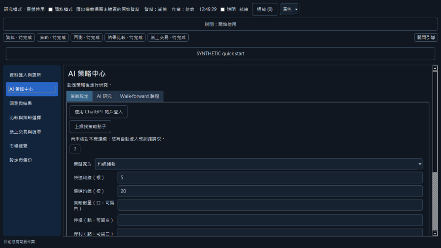
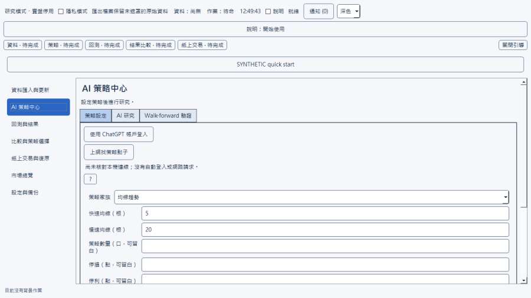
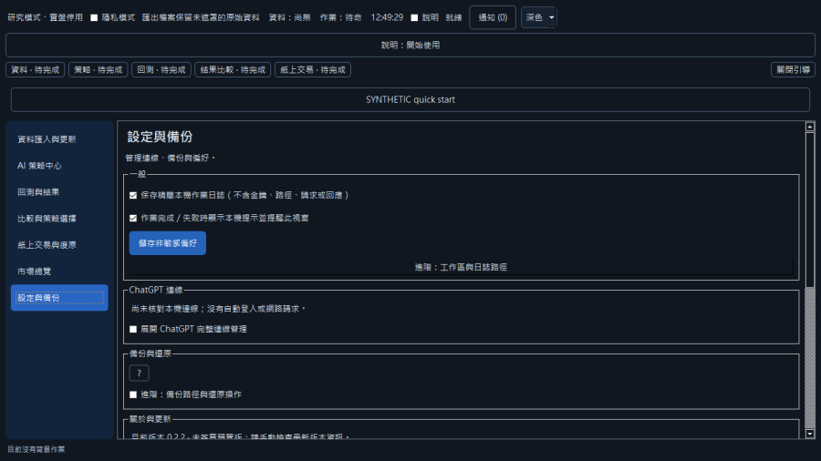
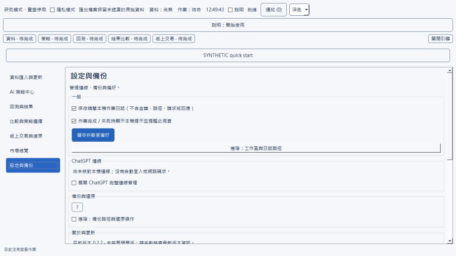

# 全功能測試報告（2026-10-22）

測試對象：main `8c4c870`（含 #75 上網找策略點子、#77 ChatGPT 登入修正、#78 分頁樣式）。執行環境：擁有者的 Windows 10（19045）電腦、Python 3.13 venv、PySide6。所有測試都使用臨時工作區與臨時 bootstrap，沒有讀寫 `%LOCALAPPDATA%\MarkAuto`，沒有連真實網站或 ChatGPT，也沒有下任何真實委託。

## 結論

- 4 組功能區共 170 項檢查：**通過 138 項**；**失敗 3 項**，都源自同一個已修正的問題（問題 1）或一個輕微的訊息問題（問題 2）；**未測 29 項**，多半是該功能沒有可取消的長作業，或只有下拉選單、沒有自由輸入（原因見附錄）。
- 離線測試分片：desktop 全數通過；paper、remaining、research 的失敗全屬本機環境因素，在 PR 前的基準 `493dc96` 上同樣出現（見「離線分片」）。
- 深色／淺色可讀性：在真實 Windows 視窗模式下，`7db4ef8` 的深色分頁對比只有 1.41；`8c4c870`（#78）修正後已無分頁低對比。只剩市場總覽搜尋欄的提示文字在深色主題對比 4.46（標準 4.5），屬輕微。
- 帳號實測：**未執行**。擁有者電腦的 ChatGPT 帳戶狀態為 `reserved_unknown`，解除方式要等 PR #76 的人工核對流程經擁有者核准並實作；PR #76 目前仍是草稿、沒有審核紀錄。

## 發現的問題與對應 PR

| # | 嚴重度 | 問題 | 狀態 |
|---|---|---|---|
| 1 | 中 | 匯入少於 16 根 K 棒的有效資料後，畫面誤報「輸入驗證失敗，作業未完成」，沒有完成通知，之後每次作業與每次重開都重複出現。根因：`desktop_pages/views.py` 的 `_refresh_dataset_views` 計算 Walk-forward（需 8 根）與示範研究（需 16 根）預設值時沒有檢查根數。 | 已修正：PR #79（含回歸測試） |
| 2 | 輕 | 手動交換匯入或匯出遇到驗證錯誤（JSON 格式錯、重複欄位、試驗次數少於家族數）時，只顯示「作業執行失敗，請檢查輸入與作業狀態後重試」，沒有說明是輸入驗證問題。根因：`desktop_pages/job_progress.py` 的 `failure_notice` 只依失敗階段產生訊息，忽略工作程序回報的 `error_code`。 | 未修：修法會改變所有作業失敗時的訊息，以及固定的通知 fixture，建議擁有者決定訊息規則後另案處理。輸入確實會被拒絕，沒有資料寫入。 |
| 3 | 中 | 深色主題的「AI 策略中心」分頁與紙上交易分頁在真實 Windows 上是白底淺字（對比 1.41）。 | 已修正並合併：PR #78 |
| 4 | 高 | 自 `091902a` 起，所有 ChatGPT 連線背景作業（讀取已保存連線、登入、取得模型）都因 `model` 欄位不在白名單而無法啟動。 | 已修正並合併：PR #77 |
| 5 | 輕 | 市場總覽搜尋欄提示文字在深色主題對比 4.46，略低於 4.5。 | 未修，記錄為後續改善 |

所有回報的問題都由另一個代理獨立重跑、試著推翻後才列入；被判定為環境因素或測試腳本錯誤的不列入。

## 分頁可讀性修正前後（真實 Windows 視窗、windowsvista 樣式、深色主題）

修正前（`7db4ef8`）：

修正後（`8c4c870`）：

修正後的整頁畫面（深色／淺色）：

可讀性以 `tools/ui_readability_audit.py` 量測：逐頁、逐分頁，在 Fusion 與 windowsvista 兩種樣式、深色與淺色兩種主題下截圖，計算每個文字元件的 WCAG 對比。離線（offscreen）模式畫不出 Windows 原生的分頁，所以分頁問題要用 `QT_QPA_PLATFORM=windows` 的真實視窗模式才重現得出來。

## 各功能結果

每格代表該功能在該項目的結果。「通過」附有測試名稱或腳本觀察到的證據（保存在測試工作流程的紀錄裡），「失敗」對應上方問題，「未測」原因見附錄。

### 資料匯入與更新；市場總覽

| 功能 | 正常操作 | 錯誤輸入 | 取消 | 重開後保留 | 深色可讀 | 淺色可讀 |
|---|---|---|---|---|---|---|
| ui_demo (create synthetic data) | 通過 | 未測 | 通過 | 通過 | 通過 | 通過 |
| ui_import (synthetic_taifex_ticks) | 失敗 | 通過 | 未測 | 失敗 | 通過 | 通過 |
| ui_market_refresh with local_path (TWSE JSON) | 通過 | 通過 | 通過 | 通過 | 通過 | 通過 |
| ui_refresh (network_opt_in False) | 通過 | 通過 | 未測 | 通過 | 通過 | 通過 |
| Market overview: search box | 通過 | 通過 | 未測 | 通過 | 通過 | 通過 |
| Market overview: instrument switching and timeframes | 通過 | 未測 | 未測 | 通過 | 通過 | 通過 |
| Market overview: layouts/presets | 通過 | 通過 | 未測 | 通過 | 通過 | 通過 |
| Market overview: chart pop-out | 通過 | 通過 | 通過 | 通過 | 未測 | 未測 |
| Market overview: empty states | 通過 | 通過 | 通過 | 通過 | 通過 | 通過 |

### AI 策略中心（策略設定、AI 研究、Walk-forward 驗證、上網找策略點子）

| 功能 | 正常操作 | 錯誤輸入 | 取消 | 重開後保留 | 深色可讀 | 淺色可讀 |
|---|---|---|---|---|---|---|
| Strategy settings (family switching, parameter validation) | 通過 | 通過 | 未測 | 通過 | 通過 | 通過 |
| AI research (fixture campaign, candidates, ChatGPT plan inert) | 通過 | 通過 | 通過 | 通過 | 通過 | 通過 |
| Manual exchange export/import | 通過 | 失敗 | 未測 | 通過 | 通過 | 通過 |
| Walk-forward wizard | 通過 | 通過 | 通過 | 通過 | 通過 | 通過 |
| Web idea research dialog | 通過 | 通過 | 通過 | 未測 | 通過 | 通過 |

### 回測與結果；比較與策略選擇；紙上交易與復原

| 功能 | 正常操作 | 錯誤輸入 | 取消 | 重開後保留 | 深色可讀 | 淺色可讀 |
|---|---|---|---|---|---|---|
| Backtest (single family, batch, candidate) | 通過 | 通過 | 通過 | 通過 | 通過 | 通過 |
| Result tables/charts/report export | 通過 | 未測 | 未測 | 通過 | 通過 | 通過 |
| Comparison (ui_compare) | 通過 | 通過 | 未測 | 通過 | 通過 | 通過 |
| Strategy select/disable (ui_select/ui_disable) | 通過 | 未測 | 未測 | 通過 | 通過 | 通過 |
| Paper: demo policy, snapshot, reconcile | 通過 | 通過 | 未測 | 通過 | 通過 | 通過 |
| Paper submit (synthetic quote) / cancel / cancel-all | 通過 | 通過 | 通過 | 通過 | 通過 | 通過 |
| Emergency stop (ui_paper_kill) and explicit resume | 通過 | 通過 | 未測 | 通過 | 通過 | 通過 |
| Paper replay (ui_paper_replay) | 通過 | 通過 | 通過 | 通過 | 未測 | 未測 |
| Capital scenario on saved walk-forward | 通過 | 通過 | 未測 | 未測 | 未測 | 未測 |

### 設定與備份；說明、快速開始、通知

| 功能 | 正常操作 | 錯誤輸入 | 取消 | 重開後保留 | 深色可讀 | 淺色可讀 |
|---|---|---|---|---|---|---|
| Manual backup create/restore | 通過 | 通過 | 未測 | 通過 | 通過 | 通過 |
| Automatic backup settings | 通過 | 通過 | 未測 | 通過 | 通過 | 通過 |
| Appearance theme and rise/fall convention | 通過 | — | — | 通過 | 通過 | 通過 |
| Privacy mode | 通過 | — | — | 通過 | — | — |
| Logs (persist toggle, read, export) | 通過 | 未測 | — | 通過 | — | — |
| Help panel and onboarding | 通過 | — | — | — | 通過 | 通過 |
| Synthetic quick start chain | 通過 | 通過 | 通過 | — | — | — |
| Notifications banner/history/button count | 通過 | — | 未測 | 通過 | 通過 | 通過 |

## 離線分片（main `8c4c870`）

| 分片 | 結果 | 失敗的判定 |
|---|---|---|
| core desktop | 425 項 OK（略過 8） | — |
| core paper | 169 項，3 失敗、1 錯誤 | 全在 `test_paper_diagnostics`（外部探測程序），`493dc96` 基準上完全相同 → 環境 |
| core remaining | 2062 項，4 失敗、21 錯誤 | symlink／hardlink 權限（WinError 1314）、原生程序測試（`test_windows_recovery_feasibility`、`test_test_group`），以及暫存檔被鎖的 `test_cli`；全部在基準上也會出現 → 環境 |
| research | 243 項，8 錯誤 | 全是暫存檔 `os.replace` 被拒（WinError 5）。交換順序重跑：基準與 main 都會隨機失敗 3 到 5 個 → 環境（推測為防毒即時掃描） |

CI（GitHub Actions）上相同的分片在 #77、#78 合併前都已全綠。

## CI 與合併紀錄

- #77：CI 共 4 輪。第 1 到 3 輪都是逾時：`ui` 跑滿 15 分鐘被取消、smoke 40 秒、PowerShell 8 秒、Walk-forward smoke 清理、Ubuntu 3.12 跑滿 15 分鐘，沒有任何測試斷言失敗。第 4 輪 24 項全綠，以 head `37fa05d` squash 合併為 `41fb0d0`。
- #78：第 1 輪逾時，第 2 輪 24 項全綠，以 head `344c369` squash 合併為 `8c4c870`。
- main `8c4c870` 的 Windows 安裝檔建置成功，但同一 commit 的離線測試又有兩項跑滿 15 分鐘被取消，因此發布被拒；依 G8 重跑後發布成功（見發布紀錄）。
- `ui` 與 Ubuntu 的離線測試工作長期跑 12 到 15 分鐘，貼近 15 分鐘上限，在 #75 之前就是如此，會隨機擋住無關的 PR，建議另案處理（已提出任務卡）。

## 發布紀錄

- main `8c4c870`（#77 + #78）：Windows 安裝檔建置成功；第一次發布因同一 commit 的離線測試有兩項跑滿 15 分鐘被取消而被拒。依 G8 整輪重跑離線測試（第 2 次）全綠後，重跑發布步驟成功。
- 下載頁：https://github.com/yostar77612/mark-auto/releases/tag/desktop-preview-39775999074-2
- 安裝檔：`MarkAuto-0.2.2-windows-x64-setup.exe`（約 40 MB）：https://github.com/yostar77612/mark-auto/releases/download/desktop-preview-39775999074-2/MarkAuto-0.2.2-windows-x64-setup.exe
- 檢查碼：`SHA256SUMS.txt`：https://github.com/yostar77612/mark-auto/releases/download/desktop-preview-39775999074-2/SHA256SUMS.txt
- 這個 preview 不含 PR #79（短資料誤報修正）；#79 合併後的 main 會另外產生新的 preview。

## 仍需擁有者親自驗證

1. 安裝新 preview 後，在真實 Windows 上目視確認深色與淺色主題的分頁、按鈕與提示文字（測試只用了離線與真實視窗截圖）。
2. ChatGPT 登入：#77 修正後應可按「使用 ChatGPT 帳戶登入」開啟官方授權頁，需你本人登入確認。
3. `reserved_unknown`：先決定 PR #76 的 D1 到 D4，實作人工核對流程後，才能做第 14 節的帳號實測（模型清單、搜尋測試、完整與固定來源模式各一次）。
4. 問題 2（訊息規則）與問題 5（提示文字對比）是否處理。

## 附錄：未測項目與原因

| 功能區 | 功能 | 項目 | 原因（測試代理的說明，英文原文節錄） |
|---|---|---|---|
| 資料匯入與更新；市場總覽 | ui_demo (create synthetic data) | 錯誤輸入 | bars is a QSpinBox clamped to 120..10000, no free-text error input exists in the GUI. |
| 資料匯入與更新；市場總覽 | ui_import (synthetic_taifex_ticks) | 取消 | Import of the 2-row fixture finishes instantly; no cancel window. Generic job cancel verified with ui_demo. |
| 資料匯入與更新；市場總覽 | ui_refresh (network_opt_in False) | 取消 | The job is refused immediately; nothing to cancel. |
| 資料匯入與更新；市場總覽 | Market overview: search box | 取消 | No cancel semantics on a search field. |
| 資料匯入與更新；市場總覽 | Market overview: instrument switching and timeframes | 錯誤輸入 | Selection is combo-only; no free-text input. |
| 資料匯入與更新；市場總覽 | Market overview: instrument switching and timeframes | 取消 | No cancel operation. |
| 資料匯入與更新；市場總覽 | Market overview: layouts/presets | 取消 | Name dialog not driven in offscreen script; covered by test_market_workspace_c5 only at store level. |
| 資料匯入與更新；市場總覽 | Market overview: chart pop-out | 深色可讀 | Pop-out window itself not included in the contrast audit (only the main page). |
| 資料匯入與更新；市場總覽 | Market overview: chart pop-out | 淺色可讀 | Same reason as dark. |
| AI 策略中心（策略設定、AI 研究、Walk-forward 驗證、上網找策略點子） | Strategy settings (family switching, parameter validation) | 取消 | No cancel concept for settings edits. |
| AI 策略中心（策略設定、AI 研究、Walk-forward 驗證、上網找策略點子） | Manual exchange export/import | 取消 | Export/import jobs finish in well under a second; cancel covered by the general campaign cancel check. |
| AI 策略中心（策略設定、AI 研究、Walk-forward 驗證、上網找策略點子） | Web idea research dialog | 重開後保留 | Idea store persistence only exercised by tests (IdeaStore load/retry in test_idea_research); not re-driven through a rebuilt window. |
| 回測與結果；比較與策略選擇；紙上交易與復原 | Result tables/charts/report export | 錯誤輸入 | No separate error flow for the result display or export. Only the backtest error inputs above were exercised. |
| 回測與結果；比較與策略選擇；紙上交易與復原 | Result tables/charts/report export | 取消 | Export is part of the backtest job. Cancel was tested only on the backtest job. |
| 回測與結果；比較與策略選擇；紙上交易與復原 | Comparison (ui_compare) | 取消 | The comparison is a short job. Cancel was not exercised separately. |
| 回測與結果；比較與策略選擇；紙上交易與復原 | Strategy select/disable (ui_select/ui_disable) | 錯誤輸入 | The empty-selection guard (result_required) is in the code but I did not trigger it. |
| 回測與結果；比較與策略選擇；紙上交易與復原 | Strategy select/disable (ui_select/ui_disable) | 取消 | Short job, not exercised. |
| 回測與結果；比較與策略選擇；紙上交易與復原 | Paper: demo policy, snapshot, reconcile | 取消 | Snapshot and reconcile are short read-style jobs. |
| 回測與結果；比較與策略選擇；紙上交易與復原 | Emergency stop (ui_paper_kill) and explicit resume | 取消 | The stop dialog's cancel and observe branches were not driven; the dialog was auto-confirmed. |
| 回測與結果；比較與策略選擇；紙上交易與復原 | Paper replay (ui_paper_replay) | 深色可讀 | The replay controls were not visible in my driver run. |
| 回測與結果；比較與策略選擇；紙上交易與復原 | Paper replay (ui_paper_replay) | 淺色可讀 | The replay controls were not visible in my driver run. |
| 回測與結果；比較與策略選擇；紙上交易與復原 | Capital scenario on saved walk-forward | 取消 | No cancel path exercised. |
| 回測與結果；比較與策略選擇；紙上交易與復原 | Capital scenario on saved walk-forward | 重開後保留 | Not exercised in my driver. |
| 回測與結果；比較與策略選擇；紙上交易與復原 | Capital scenario on saved walk-forward | 深色可讀 | The page is not part of the three pages I audited. |
| 回測與結果；比較與策略選擇；紙上交易與復原 | Capital scenario on saved walk-forward | 淺色可讀 | The page is not part of the three pages I audited. |
| 設定與備份；說明、快速開始、通知 | Manual backup create/restore | 取消 | Backup job is short; no cancel path driven. Covered indirectly by existing job tests. |
| 設定與備份；說明、快速開始、通知 | Automatic backup settings | 取消 | No cancel UI for the settings save; browse dialog not driven. |
| 設定與備份；說明、快速開始、通知 | Logs (persist toggle, read, export) | 錯誤輸入 | Export to unwritable target not driven. |
| 設定與備份；說明、快速開始、通知 | Notifications banner/history/button count | 取消 | Dismiss/clear actions covered only by existing tests. |
