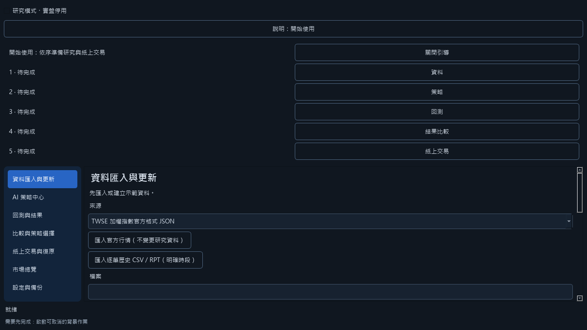
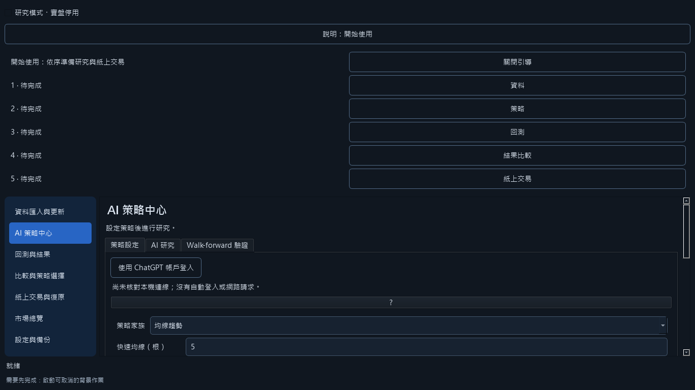
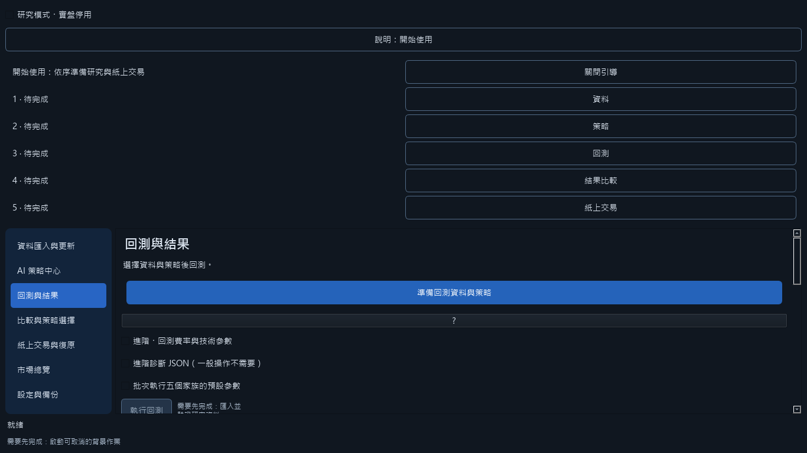
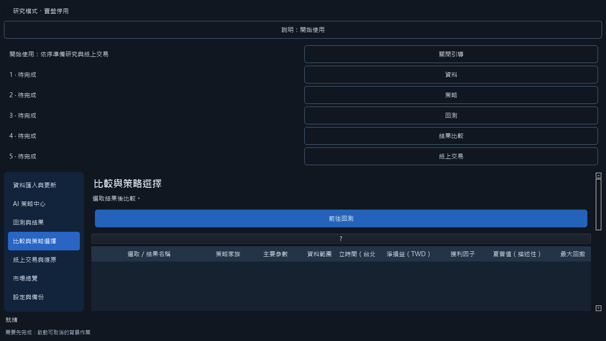
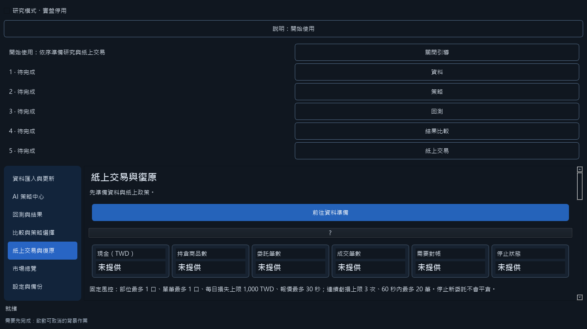
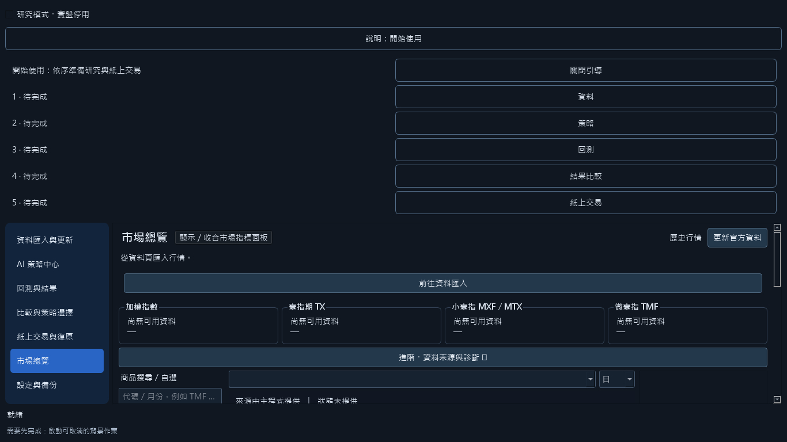
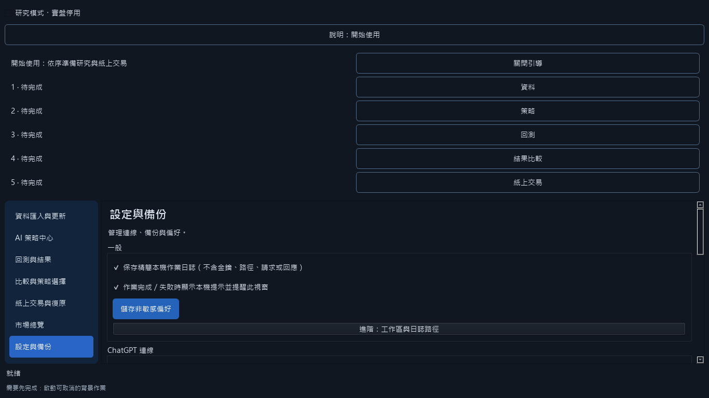

# MarkAuto 使用手冊

回測結果的「交易結構」以已平倉 FIFO 批次的淨損益計算期望值、平均獲利、平均虧損、盈虧比、勝率、最長連虧及最大單筆獲利占比。
標題「回測樣本（參數經挑選），僅供描述」提醒這是挑選參數後的樣本描述，不能推論未來優勢，也不改變研究資格或紙上資格。
打平盈虧比是虧損批次數除以獲利批次數；打平勝率是 1 ÷（1 + 盈虧比），含打平批次時附原因而不顯示數值。
空帳本或沒有獲利／虧損批次時，無法計算的值顯示原因。警訊以「高嚴重度／中嚴重度」文字標示，非交易建議；隱私模式會遮蔽金額。

桌面版是產品介面；`tools/research_app.py`（Streamlit）僅供開發者研究，不包含在安裝包中。

MarkAuto 是離線研究與紙上模擬工具，實盤永久停用，不會連接券商下單。TX／MTX／TMF 可供市場展示，目前研究與紙上資格仍限已驗證 TMF。示範行情、費率與保證金是假設，不是獲利或實際成交保證。

截圖來自 1366×768 離屏全新暫存工作區，不含使用者資料。以下依側邊欄順序介紹；操作流程則是資料 → 策略 → 回測 → 比較 → 紙上交易。

## 開始前檢查清單

- [ ] 從專案 Releases 下載安裝程式，核對同版本 SHA256，保留 Windows 安全防護。
- [ ] 初次練習使用「建立合成示範資料」，不需登入或連線。
- [ ] 真實資料須核對使用權、實際合約、交易日曆、到期日與夜盤歸屬。
- [ ] 核對成本、資金與風控；不把示範績效當成真實能力。
- [ ] 完成一次離線回測及比較，再進入紙上帳戶；需要時先備份。

## 資料匯入與更新

用途：準備研究行情，或下載官方公開資料到本機；下載不會自動替換研究資料。

1. 初次練習按「建立合成示範資料」，它產生可重現的假行情。
2. 自備資料先選研究格式，按「選擇資料檔案」，依欄位填合約、時段與到期日。
3. 按「選擇交易日曆」提供已核對日曆；程式不猜休市日或夜盤歸屬。
4. 核對後按「匯入並驗證資料」。被拒絕時依提示修正來源，不略過驗證。
5. 要取官方近期資料，先勾選「同意本次連線至 TAIFEX 下載免費公開資料（不會自動匯入）」，再按「下載最近交易日資料」。下載後仍須明確匯入。

「匯入官方行情（不變更研究資料）」供市場圖表使用。內建到期日只涵蓋有限月份，其他月份及週契約須自行核對。

## AI 策略中心

用途：選有限策略家族及受驗證參數，或保存研究候選；不執行任意 Python 策略。

### 策略設定

1. 切到「策略設定」，選內建家族，依欄位標籤調整參數。
2. 初學者保留明示示範值，再到回測頁測試；進階 JSON 供完整核對使用。
3. 「使用此不可變候選版本進行研究回測」選用已保存版本；「改用內建家族與可編輯參數」回到可編輯設定。選用不代表通過 OOS 或取得紙上資格。

### AI 研究

1. 切到「AI 研究」，選來源；離線練習明確選「離線示範（非真實 AI，需明確選取）」，只驗證流程。
2. 官方訂閱在設定頁「ChatGPT 連線」管理登入，本人核對官方 credits／用量設定。登入成功不代表真實推論已驗證。
3. 「核對本次訂閱研究請求紀錄（不連網）」只核對既有用量；核對資料切分與本次同意後，按「生成／重開研究與樣本外」。不足額度或缺少同意會封鎖。
4. 手動模式按「匯出手動 AI 請求與回應格式」，自行傳送後用「選取手動 AI 回應檔」或貼回欄位匯入，勿含帳密；不會升級為已驗證模型。
5. 查看保存候選的訓練／驗證結果，再決定回測或分析。AI 解讀可能錯誤，不會自動套用參數或下單。

### Walk-forward 驗證

依序以過去資料選策略、以前推區間檢查。按「下一步」前進、「上一步」返回，不能跳過驗證。

1. **選擇候選池**：內建池或已保存研究池二擇一；保存池須對應原始資料。
2. **選擇資料**：核對目前匯入資料，更換資料請回資料頁，不套用回測頁日期篩選。
3. **設定窗口**：選「快速」、「標準」、「嚴格」或「自訂」，核對訓練、驗證、前推與保留集長度、門檻、費用及評估上限。
4. **預覽切分**：查看每輪範圍、候選數與最大評估次數；預覽不消耗新評估範圍，最終保留集排除且不評估。
5. **確認並執行**：閱讀一次性消耗說明，明確勾選同意後執行，再查看各輪結果。可能沒有贏家，通過不保證獲利。

**一次性 OOS 同意**：已保留／消耗的樣本外範圍不因取消、失敗、重啟、換工作區或還原而退還。不要修改帳本重試；查閱保存結果不重跑 OOS。樣本外與保留集不得回饋生成器。

**樣本外統計**：結果區合併成功評估且日期不重疊的樣本外每日報酬，顯示觀測天數、平均日報酬比值、單尾 Student t 與平移重抽兩種 p 值、95% 百分位信賴區間，以及「目前 N 天，建議至少 M 天」。p 值的意思是「假設沒有優勢時，出現至少這麼好結果的機率」，不是策略無效的機率，也不保證未來獲利。所需樣本數以 alpha 0.05、power 0.8 估計，下限 30 天；平均不大於 0、變異數為 0、樣本不足或任何每日報酬缺值時顯示原因，不補值也不丟棄。日期重疊、缺少報酬清單或最終保留集排除狀態未確認時拒絕統計。資料限 20 個 fold，最終保留集不讀取、不評分、不顯示。重抽預設固定種子 20261021、5000 次，運算目標上限為觀測數乘重抽次數 5000 萬，降低次數時保留至少 1000 次，因此超過 5 萬觀測時以此下限優先。這些唯讀顯示不改變資格、候選排序或紙上權限。

## 回測與結果

用途：在明示成本與資金假設下，檢查目前策略的歷史結果。

1. 先完成資料與策略選擇，核對日期範圍、商品及合約。
2. 核對費用、資金、保證金及到期日；預設為示範假設，完整欄位在「進階・回測費率與技術參數」。
3. 按「執行回測」等待完成摘要。「批次執行五個家族的預設參數」測試內建預設，不代表找到最佳策略。
4. 查看淨損益、最大回撤、交易數與權益圖；未定義或未成立的統計不是零，也不是可用績效。
5. 「市場圖表：顯示已驗證回測訊號」及「市場圖表：顯示已驗證回測成交」把核對過的研究結果放到市場圖，不是真實成交紀錄。

次棒成交與成本規則維持；歷史結果不保證未來，也不代表具備紙上資格。

### 報告匯出

匯出報告的資料夾附有 `SOURCE.txt`，以固定說明標示合成示範（`synthetic`）、代理資料（`proxy`）或本機官方資料（`official_local`）。合成資料不是實際行情或成交；官方行情的回測成交也仍是模擬。未知來源會拒絕匯出。原有 CSV／JSON 內容不變，分享報告時請一併保留來源說明。

## 比較與策略選擇

用途：在一致資料與成本條件下比較保存結果，明確決定研究／紙上策略。

1. 勾選多個保存結果，按「比較選取結果」；沒有結果先回回測頁。
2. 核對來源、日期、成本及資格，再比較損益與回撤，避免把不同假設當作同一排名。
3. 選可用結果後按「啟用目前回測策略（僅研究／紙上）」；資格不符時依提示補核對，不開啟實盤。
4. 「停用策略並停止紙上新委託」阻止後續新委託，不會平掉既有部位。

## 紙上交易與復原

用途：以本機帳本模擬委託及歷史重播，在重啟或異常後核對狀態。

1. 初次練習按「填入明示合成示範政策」；已有核對資料時按「載入已核對的政策檔案」，不能猜合約與時段。
2. 按「讀取／建立紙上帳戶」，確認帳號、資金、部位與狀態；讀取不是對帳成功。
3. 初始空帳戶依表單明示填寫；已有部位或委託時按「載入外部完整參考快照」，逐項核對，再按「明確對帳紙上帳戶」。載入本身不送單。
4. 每次重播／委託前，勾選「我已核對上方參考快照，並同意本次重播／委託前對帳」，再按「重播選定策略一批歷史資料」。策略須先啟用並通過資格。
5. 需要立即禁止新委託時按「緊急停止：禁止紙上新委託」，再確認停止；「僅觀察」也會持久鎖定新委託。停止不平倉、不撤銷既有委託；重啟、對帳及再次勾選同意均不會解除鎖定。
6. 恢復時先核對完整參考快照，在進階區按「恢復新委託（需先對帳）」。系統先完成對帳才明確解鎖，無須重啟；未知委託或對帳不符仍拒絕恢復。恢復後，每次送單／重播仍須重新勾選同意。

鎖定期間送單、重播、改價與單筆撤單不可操作，對帳及恢復按鈕仍可用。停止與取消委託是不同操作；取消指定委託需先處理鎖定並核對帳戶。一般重播批次結束只設定批次停止開關，不建立手動委託鎖定，下一批可照常開始。

進階區的「送出紙上委託」依明示報價、時間及風控模擬委託；「取消紙上委託」依 ID 取消可取消委託，不能撤銷已成交事件。歷史重播採次棒成交，不支援盤中停損停利；先處理停止原因及未核對狀態。

停止對話框會列出未成交委託筆數與買／賣剩餘口數，停止後仍保留。如需撤單，展開進階區按「撤銷全部未成交」，核對筆數後明確確認；預設與 Esc 均取消。沒有未成交委託時只顯示提示。此動作在停止鎖定時仍可用，不解鎖、不平倉；恢復新委託仍須另行對帳。結果顯示撤銷與失敗筆數，單筆失敗不中斷其他委託，重複執行不重複記錄。

## 市場總覽

用途：觀看本機歷史行情與研究圖層，沒有即時行情或實盤連線。

1. 空白時先至資料頁載入行情；合成資料會明示為示範。
2. 在「商品搜尋 / 自選」找實際合約，按「＋ 加入自選」保存觀看項目；「移除」只移除自選。
3. 選「圖表實際商品合約」及「K線週期」，再調整指標參數。日／時段資料不能轉成不存在的分鐘行情。
4. 「更新官方資料」須經本次網路同意後在背景下載；有來源與日期，不保證即時。
5. 「匯入本機 TAIFEX 逐筆歷史」須自行填寫合約、交易日、台北開收盤日期時間及端點，確認後按「背景匯入已確認時段」；它不改變研究資料。

「進階・資料來源與診斷 ▸」提供完整來源核對。OHLC 圖形不能證明真實委託的成交順序。

## 設定與備份

用途：管理偏好、連線、工作區與備份，不重設不可逆額度。

1. 在「一般」調整提示與日誌，再按「儲存非敏感偏好」。
2. 在「ChatGPT 連線」按「展開 ChatGPT 完整連線管理」看登入及額度狀態；本人決定是否授權，勿分享登入資料。
3. 在「備份與還原」選工作區與應用資料夾以外的位置，按「建立本機備份」。也可勾「啟用每日自動備份（預設關閉）」並「儲存自動備份設定」；只在開啟且閒置時嘗試，取消／失敗當日不重送，不自動刪除舊備份。
4. 還原前展開「進階：備份路徑與還原操作」，核對封存位置，勾「我確認還原會替換目前本機狀態，並會要求重新對帳」，待背景工作停止後按「驗證並還原備份」。
5. 「關於與更新」的「開啟專案 Releases 頁面」只開網頁，不自動下載或執行。

展開「進階：工作區與日誌路徑」查看實際位置，可按「在檔案總管開啟工作區」、「在檔案總管開啟日誌資料夾」；備份區有「在檔案總管開啟備份資料夾」。預設應用資料在 `%LOCALAPPDATA%\MarkAuto`，以實際畫面為準。「設定下次啟動工作區」不搬移或覆寫現有資料。

備份不含金鑰、快取、模型與不可逆預算紀錄；還原不退回請求或 OOS 消耗，也不代表完成對帳。

## 鍵盤快捷鍵

| 按鍵 | 功能 |
|---|---|
| Ctrl+1 | 資料匯入與更新 |
| Ctrl+2 | AI 策略中心 |
| Ctrl+3 | 回測與結果 |
| Ctrl+4 | 比較與策略選擇 |
| Ctrl+5 | 紙上交易與復原 |
| Ctrl+6 | 市場總覽 |
| Ctrl+7 | 設定與備份 |
| F5 | 重新整理目前頁面，不會替您對帳 |
| Esc | 取消進行中工作；等待停止確認，已消耗額度不退還 |

## 常見問題與排除方式

**JSON 載入被拒？** 進階 JSON 與載入的 JSON 檔案不接受重複欄位名稱（包括巢狀物件），也不接受 `NaN`、`Infinity` 或 `-Infinity`。請移除重複欄位並填入有效數值；拒絕時保留原表單內容，畫面沿用驗證失敗提示。檔案須為 UTF-8，載入上限維持原有限制。

| 啟動訊息（畫面原文） | 處理方式 |
|---|---|
| 無法啟動：資料庫引擎版本過舊。 | 安裝含 SQLite 3.51.3 或更新版本的 MarkAuto 安裝包。 |
| 無法啟動：工作區格式與此版本不相容。 | 使用相容版本或還原相容備份，保留原資料。 |
| 無法啟動：工作區正由另一個程序使用。 | 切回既有視窗，或正常關閉該程序後再啟動。 |
| 程式啟動失敗，原資料已保留。 | 重新安裝相容版本或還原相容備份；保留錯誤代碼供查詢。 |

**啟動失敗？** 先讀中文原因與錯誤代碼。SQLite 版本不足時用已驗證安裝包或依[開發者指南](../../packaging/README.md)建立私有環境，不降級檢查。工作區版本不相容時使用相容版本，不改資料檔。工作區被另一程式使用時正常關閉原程式後重試，不強刪鎖定或帳本。無法寫入時用自己可寫的位置，不提升權限覆寫。未知失敗保留代碼與日誌，勿分享帳密或完整請求內容。

**按鈕不能按？** 看旁邊的前置條件與滑鼠提示，常因未匯入資料、未選結果、未同意、未對帳或工作未停止。先完成條件，不重複點擊或重設額度。

**日誌與備份在哪？** 設定頁展開「進階：工作區與日誌路徑」及「進階：備份路徑與還原操作」看實際位置；「讀取精簡本機日誌」只讀作業名稱與結果類型。自動備份需另行啟用及選資料夾。

**登入成功不能研究？** 仍可能需要本次用量核對、明確同意、有效資料或額度。真推論待本人驗收；不提供付費 API／本機模型備援，未確認請求不得重送。

**還原或重播停止後不能繼續？** 保留原始紀錄，待工作停止，核對完整帳戶快照後明確對帳；停止不平倉，不刪紀錄繞過封鎖。

Developer workspace: run `streamlit run tools/research_app.py` from the repository root
so repository-local `.streamlit/config.toml` server/privacy settings apply.

### 樣本外統計：優勢衰減檢定

結果中的「優勢衰減檢定」固定依成功評估的 fold 索引排序，前半與後半的每日報酬各合併後做 Welch 單尾比較。奇數個 fold 的中間 fold 歸後半，不能調整切點。單尾 p 值小於 0.05 時顯示「顯著下降」；鏡像方向小於 0.05 時顯示「顯著上升（非未來保證）」。其餘顯示「看不出顯著差異（不等於沒有變化）」。

至少需要兩個成功評估的 fold，且每半至少兩天；報酬缺值、日期重疊或兩半變異數皆為零時顯示原因。檢定只讀樣本外結果，不讀最終保留集，不寫回結果或雜湊，也不改變資格、選擇、裁決或紙上權限。

### 樣本外統計：五種裁決

完成的 Walk-forward 結果會在「樣本外統計」頂端顯示裁決，與既有階段代碼分開。這是樣本外每日報酬的統計結論，不是交易許可；不影響研究資格、候選選擇、紙上資格或開始／取消操作。

依序判讀：少於 30 天或統計未定義為「樣本不足」，並列建議觀測數或無法估計的原因；平均為負為「負期望（不建議進入紙上驗證）」；任一單尾 p 值不低於 0.05 為「疑似運氣」；有高嚴重度警訊為「脆弱優勢」；其餘為「具統計優勢（仍非保證）」。中嚴重度警訊只附註，不改變等級。

嚴重回撤 severe_drawdown 由成功評估 fold 的樣本外每日報酬合併後計算：權益由 1 起算，逐日複利，取相對歷來高峰的最大跌幅；嚴格大於 50% 才觸發，等於 50% 不觸發。最終保留集不參與。未有已評估的樣本外 fold，或執行失敗、中斷、尚未完成時，只顯示原因，不顯示裁決等級。
